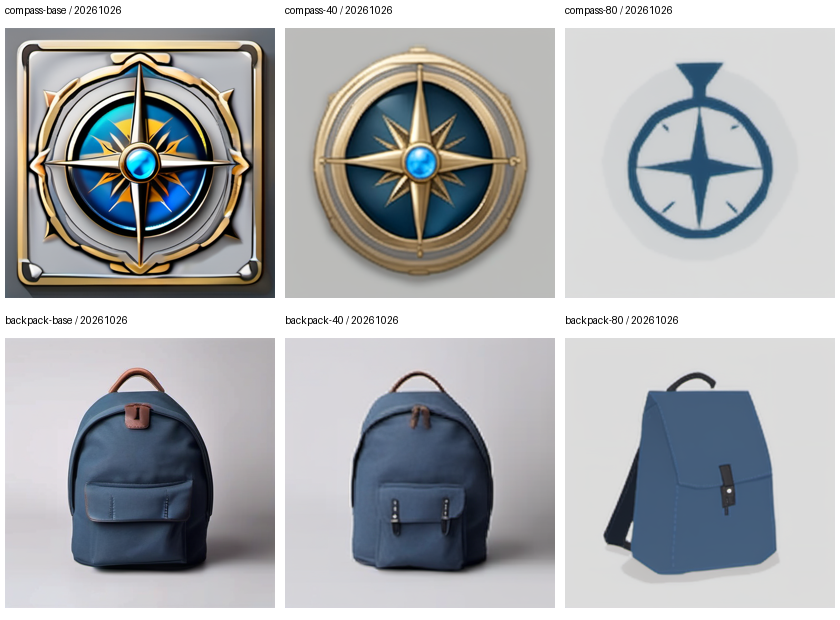
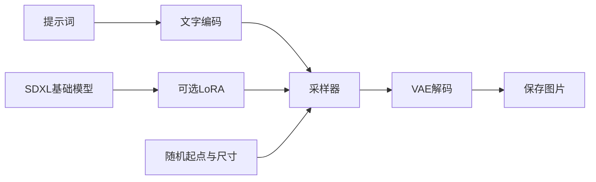
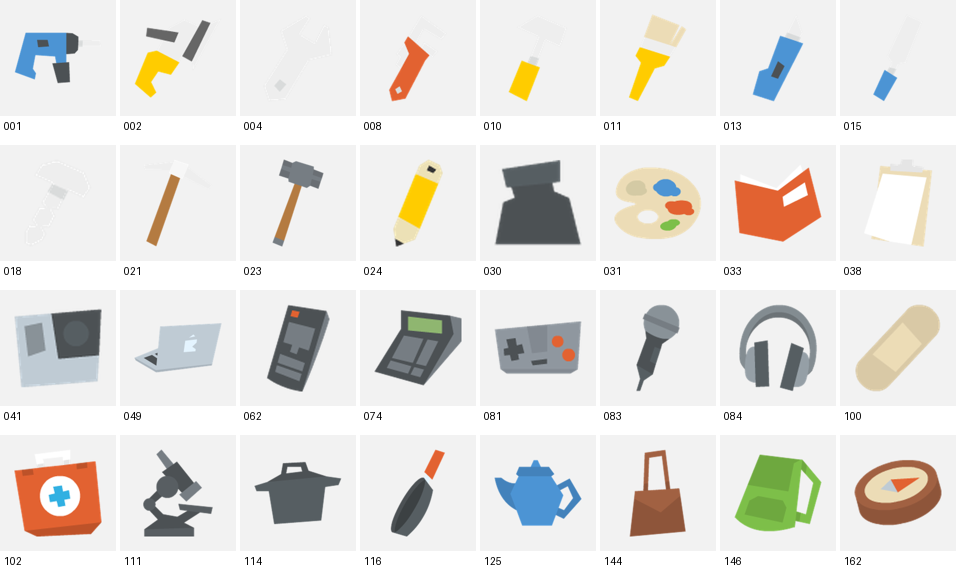
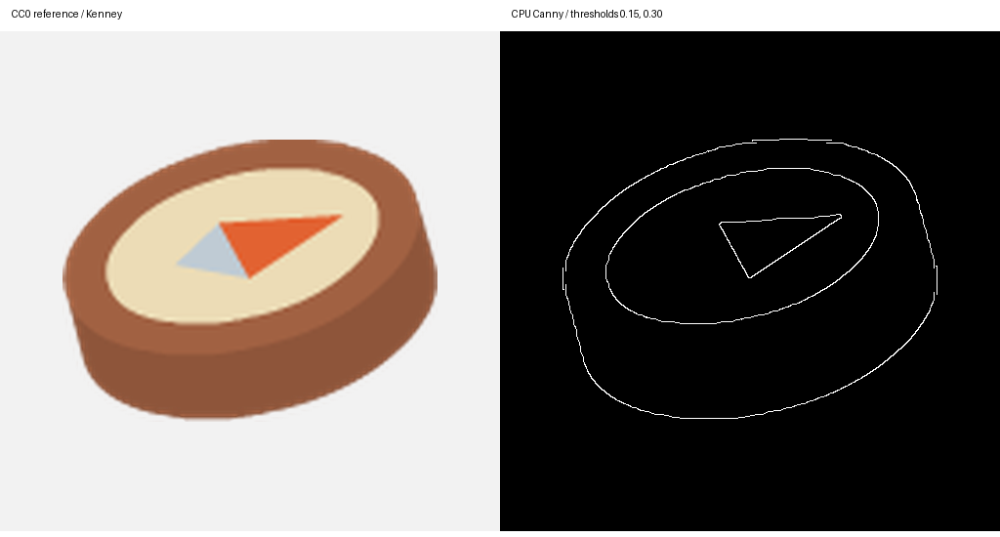

# 我用 8GB 显卡做了一次游戏图标 LoRA 小实验

我想弄清楚一件事：给已有的图像模型看一小批风格相近的素材，它能不能把这种绘制方式用在新的提示词上？

这个仓库记录我的最小尝试：**SDXL 基础出图 → Canny 结构控制 → 小规模 Style LoRA → 同条件比较**。先看结果，再按需要往下走，不要求读者先学过机器学习。



图中使用的训练素材来自 **Kenney Generic Items（CC0）**。这里的图、描述和结果属于独立重跑的公开例子；我早期使用过的私有授权素材、相关权重和实验图片没有放进这个仓库。公开素材是扁平图标风格，不能与早期手绘素材的结果混作一个实验。

## 先选一个入口

| 我现在想做什么 | 从哪里开始 |
|---|---|
| 不安装，先理解我做了什么 | 看上图，再读[博客稿](docs/blog.zh-CN.md) |
| 已经有ComfyUI，想看工作流 | 打开[工作流使用说明](#用-comfyui-真正出一张图) |
| 从零装环境 | 按[安装与下载清单](docs/SETUP.md)操作 |
| 亲手训练这个公开例子 | 按[四步训练流程](#四步训练流程)执行 |
| 核对结果、参数、耗时和局限 | 看[实验记录](results/README.md)和[机器可读摘要](results/summary.json) |

## 我们究竟在操作什么？

**SDXL** 是已经训练好的基础图像模型。我给它文字和随机起点，它逐步更新潜空间，最后由VAE解码成图片。这里没有从零训练一个大模型。

**ComfyUI** 把这个过程画成节点与连线。工作流JSON是一份操作配方；模型权重才是模型学到的参数。两者不能互相替代。

**LoRA** 是叠加在基础模型上的小适配器。这轮只更新UNet注意力中的小矩阵；基础权重与文字编码器不训练。它需要搭配原基础模型使用。



第一次只需要记住这些参数的分工：

| 参数 | 它控制什么 | 本轮生成设置 |
|---|---|---|
| seed | 随机起点；固定它方便比较 | 20261026、20261027 |
| steps | 每张图的采样更新次数 | 25 |
| CFG | 文字引导强度，不是画质分数 | 7 |
| sampler / scheduler | 更新规则与噪声安排 | Euler / normal |
| width / height | 输出宽高 | 对照512×512；另测768×512 |
| LoRA strength | 使用适配器调整的强度 | 对照1；关闭时0 |

**训练80步与生成25步是两件事。** 前者更新LoRA，后者用已经训练好的模型画一张图。

## 这次公开数据长什么样？



我选了32张训练、8张留出参考。透明背景先合成浅灰底，保留比例，最长边384，居中放到512方图上。原图本身较小，上采样不会创造真实细节。素材来源与压缩包校验值在 [data/SOURCE.json](data/SOURCE.json)，原许可在 [licenses/KENNEY-CC0.txt](licenses/KENNEY-CC0.txt)。[官方素材页](https://kenney.nl/assets/generic-items)标注CC0。

一张图对应一段可见描述，例如：

```text
iconstyle, a blue teapot, on a light gray background
```

我不把游戏价格、伤害或稀有度写进caption，因为这些信息不在图里。`iconstyle` 是约定的触发字符串；不是新增加的魔法词，也不保证模型一定学会风格。

留出图不会进入训练。两条出图测试题覆盖训练中见过的物品类别及新设计，属于小规模迁移观察，不能当作严格的未见类别泛化评测。

### Canny给轮廓，LoRA学绘制方式



Canny根据亮度变化提取边缘，输出这些线条；它不知道这是什么物品，也不保留颜色语义。它本身就包含平滑、梯度等滤波及边缘筛选步骤。ControlNet在生成时使用这些结构条件，LoRA则通过训练调整模型，两者负责不同的事情。

这张图只是CPU预处理检视，阈值0.15/0.30；不是ControlNet生成效果。可选工作流怎样使用它，见安装说明。

## 用 ComfyUI 真正出一张图

先完成[环境配置](docs/SETUP.md)，确认有基础SDXL文件。以下命令在**这个仓库根目录**的PowerShell中执行。

```powershell
.\.venv\Scripts\python.exe -B scripts/prepare_data.py
.\.venv\Scripts\python.exe -B scripts/serve.py
```

打开 **http://127.0.0.1:8190**，将以下JSON拖进画布：

| 文件 | 何时可以用 |
|---|---|
| [01_base.ui.json](workflows/01_base.ui.json) | 有SDXL基础权重就可以；不需要先训练 |
| [02_lora.ui.json](workflows/02_lora.ui.json) | 先完成本课训练，生成对应LoRA文件 |
| [03_canny_optional.ui.json](workflows/03_canny_optional.ui.json) | 选读：另需SDXL兼容的Canny控制权重 |

**第一次建议用Base。** 找到正向文字节点，看提示词；找到蓝色的`SIZE`节点，看宽高；点击Queue / 运行一次，等保存节点显示图片。工作流加载后没有历史预览是正常的。

本课不打包模型权重，LoRA工作流默认指向 `PUBLIC-ICON-R8_seed20261028_step0080.safetensors`。文件不在下拉框时，先检查是否完成训练，以及是否通过本仓库的`serve.py`登记了模型目录，不要随意下载同名第三方权重。

### 换一个物品

只修改正向文字，例如：

```text
iconstyle, a single small wooden treasure chest with brass hinges, on a light gray background
```

先保留seed和其他设置，运行一次。这个宝箱是读者练习建议，不属于已经完成的对照图。ComfyUI加载LoRA靠`LoraLoader`节点，不需要在提示词里写`<lora:...>`。

### 改宽高

在 `SIZE: width / height / batch`（节点类型`EmptyLatentImage`）中修改width和height。512是这轮训练尺寸，**不会把LoRA输出永久锁死为512**。先试768×512、batch保持1；更大分辨率需要更多显存，不能据此保证1024也能在相同负载下运行。

命令行同样可以改：

```powershell
.\.venv\Scripts\python.exe -B scripts/infer.py --lora 80 --width 768 --height 512 --name MY-WIDE-TEST
```

改尺寸会改变构图和计算量，不能和正方图混成“只改LoRA”的对照。程序接受64的倍数；这轮实际测试范围以实验记录为准。

### 关闭LoRA，看看变化来自哪里

保持Prompt和seed一致，把`LoraLoader`的`strength_model`从1改为0，`strength_clip`仍为0，各生成一张。然后可以换第40步权重比较。不要同时换seed、Prompt和强度。

练习输出在 `runs/public-demo/outputs/`，不会自动改写仓库中已经发布的结果。保存前缀带seed，改seed时也更新前缀。UI生成不会自动产生脚本那套完整性能日志；需要新增可追踪实验时使用`infer.py --name 新名字`。

## 四步训练流程

我先做短程检查，再恢复训练。所有命令都在仓库根目录执行；不要在ComfyUI正在生成图片时同时启动训练。

```powershell
# 1. 把随仓库提供的CC0原图变成统一训练输入（只用CPU）。
.\.venv\Scripts\python.exe -B scripts/prepare_data.py

# 2. 用冻结的VAE与CLIP编码32张训练图，保存本地缓存。
.\.venv\Scripts\python.exe -B scripts/cache.py

# 3. 先走完一次32图遍历：每累积4张更新一次，共8步。
.\.venv\Scripts\python.exe -B scripts/train.py --stop-after 8 --run-name smoke

# 4. 从8继续到80，不是重新开始，也不是额外再训练80步。
.\.venv\Scripts\python.exe -B scripts/train.py --resume runs/public-demo/checkpoints/PUBLIC-ICON-R8_seed20261028_step0008.resume.pt --run-name full

# 生成2个Prompt × 2个seed × Base/40步/80步，共12张对照图。
.\.venv\Scripts\python.exe -B scripts/infer.py --suite
```

配置在 [configs/train.json](configs/train.json)：512分辨率、rank8、batch1、梯度累积4、FP16、gradient checkpointing、8-bit AdamW。80次更新等于320次图片使用，32图各10次。它是小预算教学起点，不是最佳超参数声明。

`.safetensors`用于加载出图，`.resume.pt`用于恢复优化器、步数和随机状态。只加载自己信任的恢复文件。缓存绑定图片、caption、模型和脚本指纹，修改输入后不能假装旧缓存仍有效。重新试验应换`config.local.json`的`run_dir`，保留旧记录。

## 结果不理想时，我先查什么？

| 观察 | 先检查或对照 | 目前不能直接下的结论 |
|---|---|---|
| 有噪点或颗粒 | 训练原图纹理、Base同参数结果、LoRA开关/强度、采样设置、是否过度放大 | 不能一概认定“训练不够久” |
| 新Prompt效果不好 | 训练内容覆盖、caption、不同checkpoint、多个seed | 单个漂亮指南针不能代表所有物品 |
| 画成多个视图 | 单件要求与参考/训练分布；逐图检查 | 更像画风不等于更遵循结构 |
| 修改尺寸失败 | 改的是否为EmptyLatentImage；具体报错、显存与batch | 不能直接说LoRA锁定分辨率 |
| loss下降但图更差 | 对照checkpoint，排查复刻和细节丢失 | loss不是视觉质量评分 |

更大的训练集和更多更新值得试，但需要作为新实验逐项验证。数据重复、描述不匹配或过拟合也可能让加时训练无益。当前没有完成数据量、学习率或训练时长的消融，更没有统计显著性结论。

## 文件地图与许可

```text
README.md                 先读这个，先用起来
docs/SETUP.md             安装、路径配置、下载大小
docs/blog.zh-CN.md        第一人称学习记录，可作为博客稿
workflows/                Base / LoRA / 可选Canny
data/examples/            40张可公开的CC0原图
data/captions.csv          分组与可见描述
scripts/                  数据、缓存、训练、推理、小型执行器
results/                  公开实验的结果与摘要
runs/                     本机生成，Git忽略
config.local.json          本机路径，Git忽略
```

代码与文字采用 [Apache-2.0](LICENSE)；Kenney素材单独采用CC0。SDXL模型遵循其[独立许可](https://huggingface.co/stabilityai/stable-diffusion-xl-base-1.0)，不因代码许可而变成Apache模型。架构配置的来源和依赖许可见 [NOTICE](NOTICE)。

本机使用Windows、RTX3060Ti 8GB和固定软件版本。代码已在独立目录复用既有环境执行；从零安装流程没有在第二台全新机器验证。也不承诺换GPU或库版本后逐像素一致。

发布前可以执行 `python scripts/check_publication.py --package`，检查相对链接、公开素材与结果指纹，并生成 `dist/sdxl-game-icon-lab-public.zip`。原始运行目录与本机配置不会被打包；检查通过不等于已经推送到GitHub。
