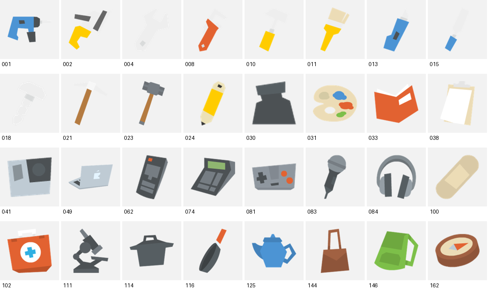
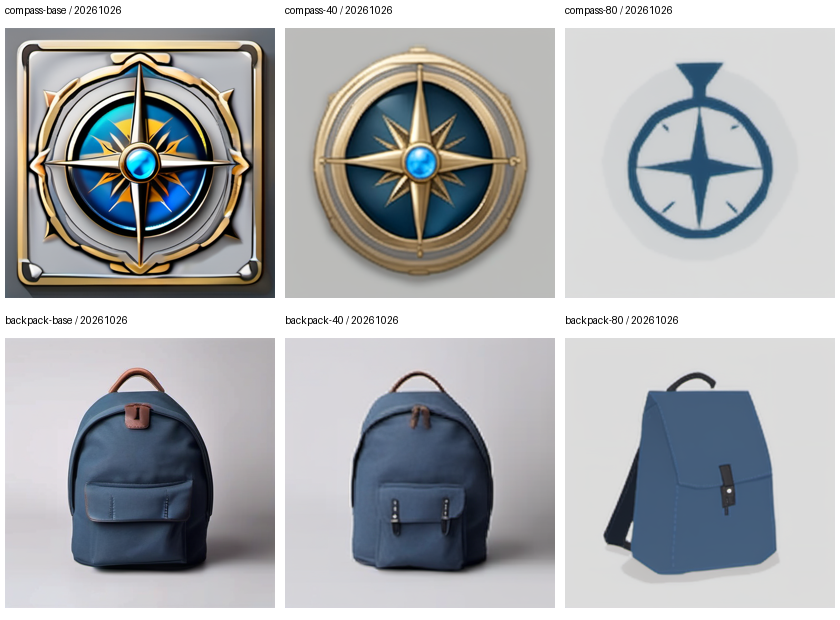

# 我用8GB显卡做了一次图标LoRA：从能出图，到知道哪里还不行

这次我想把本地图像生成真正跑一遍：给文字能出图，给轮廓能控制结构，再用一小批素材训练一个自己的适配器，最后看它到底改变了什么。

我用的是Windows和一张RTX3060Ti，只有8GB显存。范围就收得很小：单件游戏道具图标，基础模型固定为SDXL1.0，不做全参数微调。

这也是个开始。我更想留下一个别人能看懂、能检查的学习记录，而不是只贴一张最好看的图。

## 先把最容易混淆的几件事拆开

最开始我需要分清三个东西。

基础模型是已经学会生成图片的大模型。工作流是“拿哪个模型、输入什么、经过哪些步骤”的配方。LoRA则是训练出来、叠加在基础模型上的小调整；单独把它当基础模型加载不行。

ComfyUI的方框把过程展开了：读取模型、编码文字、准备起点与尺寸、采样、VAE解码、保存图片。KSampler输出的还是latent，需要VAE才能变成普通图片。

我后来再看参数，也能把它们放回各自的位置：seed控制随机起点，steps是生成更新次数，CFG影响文字引导，尺寸来自EmptyLatentImage。它们都不是越大越好的画质按钮。

## Canny与LoRA分别解决什么？

我先试了Canny结构控制。Canny从亮度变化中找边缘，本身就包含平滑、梯度和后续筛选。它没有“认出这是蓝色背包”的能力。

ControlNet使用这些线条来影响生成。因此它能帮助约束轮廓、位置和部件布局；贴近线条也可能带来背景板或不合理附件。边缘更像参考，并不自动表示画面更好。

LoRA的任务不同。这轮我想让不同物品呈现一套绘制语言，不要求它复现某一个物品的身份。这是Style LoRA。如果目标变成特定人物或物品的一致性，数据和评价也需要改变。

## 为什么公开版换了一份数据？

我最初使用的素材有本地训练授权，但不适合公开再分发。所以这个仓库重新选了 [Kenney Generic Items](https://kenney.nl/assets/generic-items)，官方标注CC0，包内也有许可说明。

公开版附了40张原图，32张训练、8张留出参考，以及我整理的简短英文描述。图片和结果是独立重跑的，不把旧实验的图片或权重换个名字放进来。

这份素材是扁平图标，和早期手绘素材不同。这个差异很重要：公开版即使看起来更干净，也不能据此说我修好了旧试验的噪点问题。

## 数据准备比“把图片扔进去”多几步

我把透明图裁到有效内容，保留比例，合成浅灰背景，再居中放到512方图。原图比较小，放大只是为了统一输入，不会凭空增加细节。

caption只描述可见内容，例如“蓝色茶壶，浅灰背景”。游戏价格、伤害、稀有度不是图片里的信息，不适合直接塞进视觉描述。

开头的`iconstyle`是约定的触发字符串。它是否建立了稳定的风格关联，要看训练后的对照，不能因为写了这个词就认定成功。

留出参考没有进入训练。不过，本轮测试题仍涉及训练中见过的物品类别，只是换了设计和文字要求，所以我把它叫作小规模迁移观察，没有包装成严格的跨类别泛化验证。

## 8GB显存下，我怎样完成训练？

我先用冻结的VAE和CLIP把32张图及其文字编码成缓存，再退出编码进程。真正训练时只加载UNet和LoRA，不让这些编码器一直占显存。

配置从512分辨率、rank8、batch1、FP16、梯度检查点和8-bit优化器开始。每4张积累梯度再更新一次，所以8个优化器step刚好走完32张图。

我先停在第8步，保存完整状态，再从那里继续到第80步。总数仍是80次更新、320次图片使用，每张10次；不是“8步加上重新训练80步”。中间保存第40步，最后比较，而不是默认最后一步最好。

实际执行还遇到一次中断：日志到第70步，但最近完整保存的是第40步。我从40步恢复，重新计算41–70，再走到80。因此最终权重仍对应80步，实际计算有额外重放；摘要把已知耗时与缺失部分分开记录，没有把丢失的计算当作零成本。

推理用的`.safetensors`只需要适配器权重；训练恢复还需要优化器、步数和随机状态，放在`.resume.pt`里。缓存、配置、模型与数据都有内容指纹，防止不知不觉换了输入还沿用旧结果。

实测耗时、显存和完整参数都在[公开实验记录](../results/README.md)，我不在文章里维护另一套可能不同步的数字。脚本使用既有环境在独立仓库运行；从零安装还没有在另一台干净机器验证。

## 看结果：一张漂亮指南针还说明不了全部

我固定两条Prompt、两个seed，比较Base、第40步和第80步，共12张。没有把ControlNet加进来，以便先看清LoRA本身的作用。

这次公开例子里，seed20261026的指南针在80步变成更简化的深蓝图形，但“黄铜、蓝色玻璃中心”的要求也弱了。背包更接近扁平图标，前袋等细节却有丢失。另一个seed的背包在Base与LoRA下都出现多视图，完整图片见[全部对照](../results/all-comparisons.png)。

这些现象支持“绘制方式确实变化了”，还不能支持“整体效果普遍提高”。这正是我想保留所有对照的原因。

阅读时我会分开问：主体对不对？绘制方式是否接近参考？有没有多视图、额外零件或变形？换seed后趋势还在不在？

我早期挑到的指南针例子很好看，但自己换Prompt试玩时，效果就没那么稳定。我也觉得某些图颗粒明显。数据少、训练短是值得检验的解释，但也可能涉及数据覆盖、caption、原图纹理、LoRA强度或过拟合。没有消融实验，就不把猜测写成结论。

同样，训练loss是噪声预测误差，不是审美评分。它下降，不代表物品结构、画风和泛化一起改善了。

## 尺寸应该是可见的参数

512是训练输入尺寸，LoRA并没有因此把输出锁死。ComfyUI要改EmptyLatentImage的width和height；命令行也明确提供了这两个参数。

我在这轮额外尝试了768×512，实际执行状态与图片记录在实验摘要中。这是单独的尺寸检查，不混进“只改变LoRA”的公平对照。更大图会占更多显存，也不能因为一张横图能跑，就保证任何1024任务都能跑。

尺寸检查成功，但图像仍有发虚和伪文字。源素材较小、预处理、训练和采样设置都值得排查；本轮没有用消融实验确定原因。把小图放大到512，也不会创造源图没有的细节。

## 我下一步想验证什么？

我会先找出失败集，而不是只保留好看的指南针。然后固定评估题，逐项比较数据覆盖、caption和训练时长；如果只改一个变量，就更容易知道差异从哪里来。

当画风比较稳定，再加入ControlNet检查结构与画风的组合。当前没有足够证据判断需要换基础模型，更没有理由直接做全参数微调。

这一轮对我最有价值的结果，是把图片、参数、训练状态和失败现象连了起来。仓库里有实际文件和命令，也保留了“还不知道”的部分。读者可以先用Base工作流画一张图，再决定是否亲手完成这次小训练。

参考：[ComfyUI官方安装](https://docs.comfy.org/installation/manual_install)、[SDXL模型卡](https://huggingface.co/stabilityai/stable-diffusion-xl-base-1.0)、[Diffusers SDXL LoRA示例](https://github.com/huggingface/diffusers/blob/v0.32.2/examples/text_to_image/train_text_to_image_lora_sdxl.py)。代码与实验整理使用了AI编码助手。公开例子的初步目视备注由助手辅助整理，尚待我逐例复核与打分。
