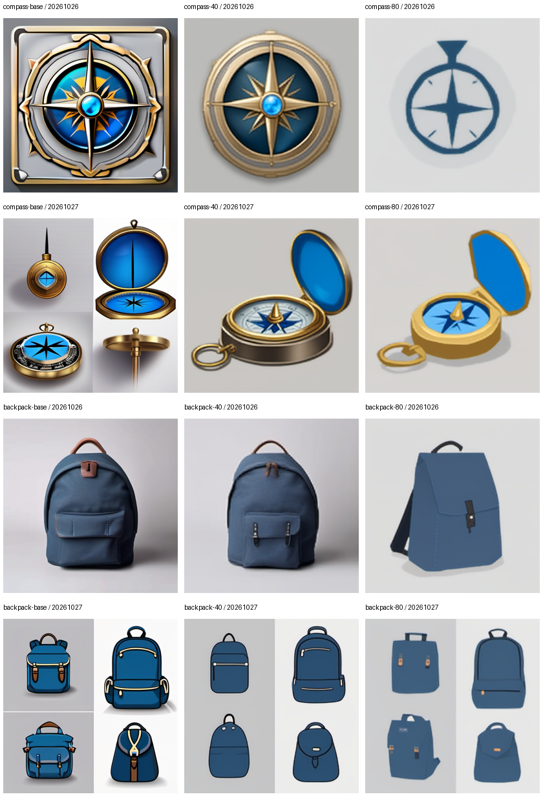

# 公开素材实验：实际记录

这里仅包含Kenney公开素材独立实验；图片导出时移除运行元数据，RGB像素未改变。参数单独保存在JSONL。

- 数据：32训练、8留出；80次更新，320次图片使用，每图10次。
- 已正常结束的训练进程合计331.31秒；计入已记录中断段后，计算时间至少675.50秒。中断退出耗时未知，不把缺失时间计为零。
- 已正常结束进程的torch allocated峰值5.238GiB；整卡采样峰值7749MiB。两者口径不同，中断段的完整显存采样未保存。
- 对照：12张512²；节点执行约12.55–17.55秒/张，排除进程启动/import/验证。
- 额外尺寸检查：1张，单独记录，不混入配对质量比较。

## 所有对照，不只选最好看的

每行相同Prompt和seed，三列依次Base、40步、80步。

| 实验 | 尺寸 | 节点秒 | 图片 |
|---|---|---:|---|
| PUBLIC-backpack-40 / 20261026 | 512×512 | 13.13 | [PNG](images/PUBLIC-backpack-40_seed20261026_00001_.png) |
| PUBLIC-backpack-40 / 20261027 | 512×512 | 16.01 | [PNG](images/PUBLIC-backpack-40_seed20261027_00001_.png) |
| PUBLIC-backpack-80 / 20261026 | 512×512 | 16.55 | [PNG](images/PUBLIC-backpack-80_seed20261026_00001_.png) |
| PUBLIC-backpack-80 / 20261027 | 512×512 | 15.78 | [PNG](images/PUBLIC-backpack-80_seed20261027_00001_.png) |
| PUBLIC-backpack-base / 20261026 | 512×512 | 12.62 | [PNG](images/PUBLIC-backpack-base_seed20261026_00001_.png) |
| PUBLIC-backpack-base / 20261027 | 512×512 | 15.34 | [PNG](images/PUBLIC-backpack-base_seed20261027_00001_.png) |
| PUBLIC-compass-40 / 20261026 | 512×512 | 15.37 | [PNG](images/PUBLIC-compass-40_seed20261026_00001_.png) |
| PUBLIC-compass-40 / 20261027 | 512×512 | 14.06 | [PNG](images/PUBLIC-compass-40_seed20261027_00001_.png) |
| PUBLIC-compass-80 / 20261026 | 512×512 | 15.08 | [PNG](images/PUBLIC-compass-80_seed20261026_00001_.png) |
| PUBLIC-compass-80 / 20261027 | 512×512 | 13.95 | [PNG](images/PUBLIC-compass-80_seed20261027_00001_.png) |
| PUBLIC-compass-base / 20261026 | 512×512 | 17.55 | [PNG](images/PUBLIC-compass-base_seed20261026_00001_.png) |
| PUBLIC-compass-base / 20261027 | 512×512 | 12.55 | [PNG](images/PUBLIC-compass-base_seed20261027_00001_.png) |
| PUBLIC-wide / 20261026 | 768×512 | 15.51 | [PNG](images/PUBLIC-wide_seed20261026_00001_.png) |

## 尺寸检查（单独条件）

768×512成功保存，说明本例没有被训练尺寸锁死；画面仍有发虚与伪文字。更大尺寸不自动等于更清晰。

## 初步目视观察（AI助手辅助，待用户复核）

- seed20261026指南针：80步更简化，但黄铜与蓝色玻璃中心等要求弱化。
- 背包：后期趋向扁平图标，前袋等细节可能丢失；seed20261027仍出现多视图。
- 这些现象说明风格发生变化，不构成总体质量或泛化改善的证明。

## 解释边界

最终权重是80步，但本机实际记录了110次更新（包括重放）。中断记录见摘要中的interruption；本次从40恢复，41–70步重新计算，最终训练轨迹仍是1–80。
没有用户打分，不给出“画质提升百分比”。画风变化、Prompt遵循、几何合理性和多样性需要分别检查。数据量/训练时间不足只是待验证解释，不是本轮证实的根因。
基础模型、LoRA权重、恢复文件、缓存及原始机器日志未加入公开仓库。本地运行记录在Git忽略的runs/目录。

[完整参数与性能JSONL](experiments.jsonl) / [摘要](summary.json) / [训练loss CSV](training-loss.csv) / [数据指纹](dataset-manifest.json)。
